# SFOS API - Architecture & UML Design Specification <a id="top"></a>

[](https://www.python.org/downloads/)
[](../LICENSE)
[](https://pypi.org/project/sfos-api/)

Comprehensive architectural specification and UML modeling for `sfos-api`, a zero-overhead, synchronous Python 3.11+ client designed for Sophos Firewall OS (SFOS) REST API.

---

## 🧭 Navigation

- [1. Executive Architectural Overview](#1-executive-architectural-overview)
  - [1.1 Core Architectural Principles](#11-core-architectural-principles)
  - [1.2 Target Appliance Internal Architecture (SFOS Kernel & Daemons)](#12-target-appliance-internal-architecture-sfos-kernel--daemons)
- [2. Component & Layered Architecture](#2-component--layered-architecture)
  - [2.1 Detailed Layer Decomposition](#21-detailed-layer-decomposition)
  - [2.2 Wire-Level Request/Response Lifecycle](#22-wire-level-requestresponse-lifecycle)
- [3. Class UML Diagram](#3-class-uml-diagram)
  - [3.1 Structural Design & Class Taxonomy](#31-structural-design--class-taxonomy)
  - [3.2 Invariant Guarantees & Type Safety](#32-invariant-guarantees--type-safety)
- [4. Use Case UML Diagram](#4-use-case-uml-diagram)
  - [4.1 Actor Profiles & Operational Scenarios](#41-actor-profiles--operational-scenarios)
- [5. Sequence Diagrams](#5-sequence-diagrams)
  - [5.1 Client Session Lifecycle & Auto-Pagination](#51-client-session-lifecycle--auto-pagination)
  - [5.2 Resource Creation & RFC 7396 Patch Update](#52-resource-creation--rfc-7396-patch-update)
  - [5.3 Convenience Wrapper: Rule Priority Reordering (Move)](#53-convenience-wrapper-rule-priority-reordering-move)
  - [5.4 Error Interception & Exception Dispatch](#54-error-interception--exception-dispatch)
  - [5.5 Idempotent State Reconciliation Workflow](#55-idempotent-state-reconciliation-workflow)
- [6. Activity & Workflow Diagrams](#6-activity--workflow-diagrams)
  - [6.1 Read & Auto-Pagination Decision Flowchart](#61-read--auto-pagination-decision-flowchart)
  - [6.2 Path Parameter Resolution Algorithm](#62-path-parameter-resolution-algorithm)
  - [6.3 Error Handling & Response Parsing Pipeline](#63-error-handling--response-parsing-pipeline)
- [7. State Transition Diagram](#7-state-transition-diagram)
  - [7.1 Client Lifecycle States & Transitions](#71-client-lifecycle-states--transitions)
- [8. Deployment & Network Topologies](#8-deployment--network-topologies)
  - [8.1 Firewall Communication Architecture](#81-firewall-communication-architecture)
  - [8.2 High Availability (HA) Cluster Topology](#82-high-availability-ha-cluster-topology)
- [9. Security Architecture & Threat Model](#9-security-architecture--threat-model)
  - [9.1 Threat Mitigation Strategies](#91-threat-mitigation-strategies)
  - [9.2 Certificate Verification Configurations](#92-certificate-verification-configurations)
  - [9.3 STRIDE Threat Analysis Matrix](#93-stride-threat-analysis-matrix)
  - [9.4 Enterprise Secrets Management & Key Storage](#94-enterprise-secrets-management--key-storage)
- [10. Concurrency, Performance & Resource Management](#10-concurrency-performance--resource-management)
  - [10.1 Concurrency Model & Thread Safety](#101-concurrency-model--thread-safety)
  - [10.2 Memory Footprint & Socket Optimization](#102-memory-footprint--socket-optimization)
  - [10.3 Connection Pool Management & Socket Tuning](#103-connection-pool-management--socket-tuning)
- [11. Extensibility & Integration Patterns](#11-extensibility--integration-patterns)
  - [11.1 Low-Level Escape Hatch (`client.request`)](#111-low-level-escape-hatch-clientrequest)
  - [11.2 Infrastructure-as-Code (IaC) Integration](#112-infrastructure-as-code-iac-integration)
  - [11.3 Idempotent Desired-State Loop Pattern](#113-idempotent-desired-state-loop-pattern)
  - [11.4 Observability, Auditing & Event Hook Interception](#114-observability-auditing--event-hook-interception)
- [12. Domain Taxonomy & Functional Subsystem Matrix](#12-domain-taxonomy--functional-subsystem-matrix)

---

## 1. Executive Architectural Overview

`sfos-api` is engineered as a lightweight, developer-ergonomic, and high-performance Python client interfacing with the **Sophos Firewall OS (SFOS) Configuration REST API** (`/api/firewall-config/v1/`). Sophos Firewall OS v20+ exposes an OpenAPI 3.0-compliant RESTful interface for provisioning and inspecting system configurations, policies, threat intelligence, and networking objects.

### 1.1 Core Architectural Principles

The architecture of `sfos-api` maps directly to the operational and security characteristics of Sophos Firewall OS:

- **Domain-Scoped `StrEnum` Architecture**: 187 firewall endpoints are structured into 29 domain classes inheriting from Python 3.11's `enum.StrEnum`. Constants evaluate directly as native strings (`str`) with zero runtime wrapper overhead, full JSON serializability, and domain-scoped IDE autocomplete (e.g. `Network.ADDRESSES_IPV4`).
- **Synchronous by Default**: Network appliance configuration is inherently linear and order-dependent (e.g. creating zones before interfaces, or placing firewall rules above catch-alls). A clean synchronous API using `httpx.Client` avoids unnecessary event loop complexity in administrative and DevOps automation scripts while preventing parallel write lock contention.
- **RFC 7396 Compliance**: All configuration modifications leverage HTTP `PATCH` with JSON Merge Patch rules (`Content-Type: application/merge-patch+json`), allowing partial updates without destructive full-object overwrites.
- **Strict HTTPS Enforcement**: Rejects insecure plaintext HTTP schemes at client instantiation to guarantee firewall administrative credentials never traverse networks unencrypted.
- **Resilient Pagination**: Eliminates manual offset arithmetic by transparently aggregating multi-page collection queries while preserving upstream pagination metadata.
- **Deterministic Resource Routing**: Combines regex template resolution with standard URL path appending and strict RFC 3986 percent-encoding (`urllib.parse.quote(id_or_name, safe="")`).

### 1.2 Target Appliance Internal Architecture (SFOS Kernel & Daemons)

To effectively automate Sophos Firewall OS, it is critical to understand how the appliance processes REST API requests behind the WebAdmin interface:

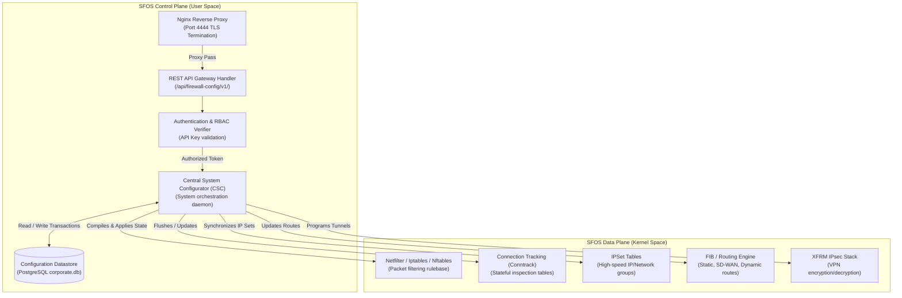

#### Control Plane Execution Sequence:
1. **TLS Termination & Ingress Filtering**: External API requests arrive at `nginx` on the configured WebAdmin port (default `4444`). Nginx terminates TLS 1.2/1.3, verifies HTTP protocol hygiene, and routes paths starting with `/api/firewall-config/v1/` to the REST API daemon.
2. **API Key & Profile Validation**: The API Gateway inspects the `Authorization: Bearer <token>` header, decodes the token against registered API credentials, and verifies that the associated administrator profile possesses appropriate Read/Write privileges for the targeted domain.
3. **Transaction Serialization via CSC**: The Central System Configurator (`csc`) daemon acts as the master transaction coordinator. Because concurrent writes to firewall rulebases can corrupt runtime packet filter state, `csc` serializes mutative operations into atomic database transactions within `corporate.db` (PostgreSQL).
4. **Data Plane Compilation**: Once a configuration record is committed to the database, `csc` triggers subsystem-specific compiler daemons. For firewall rules, this compiles rules into Netfilter chains, refreshes `ipset` hashes for address objects, and signals connection tracking to re-evaluate active flows against updated policy definitions.
5. **Architectural Consequence**: Because the appliance engine serializes configuration compilation, issuing high-frequency concurrent HTTP writes against the same firewall leads to internal lock contention and `409 Conflict` errors. The synchronous single-session design of `sfos-api` perfectly aligns with the SFOS control plane's transactional architecture.

[↑ Back to Top](#top)

---

## 2. Component & Layered Architecture

The system follows a strict 4-tier layered architecture enforcing unidirectional dependency flow:

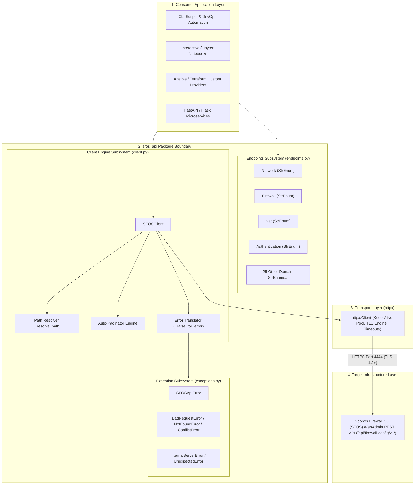

### 2.1 Detailed Layer Decomposition

1. **Consumer Application Layer**:
   - Represents the calling environment (e.g. interactive Jupyter notebooks, standalone orchestration scripts, or CI/CD pipelines).
   - Consumers interact exclusively with `SFOSClient` and import domain constants from `endpoints.py`.
2. **Endpoints Subsystem (`sfos_api.endpoints`)**:
   - Houses 29 domain classes inheriting from `StrEnum` representing 187 firewall endpoints.
   - Independent of the network layer; contains zero business logic and zero external dependencies.
3. **Core Client Engine (`sfos_api.client`)**:
   - **`SFOSClient`**: Orchestrates client operations structured into clear operational tiers:
     - **Core CRUD Primitives**: `read`, `create`, `update`, `delete` (resource lifecycle management, RFC 7396 merge patching, auto-pagination, standalone actions, and parameterized actions).
     - **Dedicated Convenience Wrappers**: `move` (rule priority reordering), `test_connection` (service connectivity & credential diagnostics).
     - **Low-Level Transport & Lifecycle**: `request` (raw HTTP escape hatch), `close` (connection pool teardown).
   - **Path Resolver**: Replaces parameterized tokens (`{idOrName}`) or appends resource identifiers with proper percent-encoding.
   - **Auto-Paginator**: Manages state across chunked pagination cycles, inspecting `pages.total` and appending `items`.
   - **Error Translator**: Inspects HTTP responses, decodes firewall JSON error bodies, and maps HTTP status codes into concrete exceptions.
4. **Transport Layer (`httpx`)**:
   - Manages connection pooling, HTTP/1.1 keep-alive persistence, TLS certificate validation, and socket timeouts.

### 2.2 Wire-Level Request/Response Lifecycle

Every API interaction in `sfos-api` traverses a rigorous 8-stage pipeline from consumer call to final Python value:

```text
[1. Method Call] ──► [2. Param Sanitization] ──► [3. Path Interpolation] ──► [4. Transport Dispatch]
                                                                                       │
[8. Return Data] ◄── [7. Auto-Pagination]   ◄── [6. Status & Parsing]   ◄── [5. Network I/O]
```

1. **Stage 1 - Ingress Method Invocation**: Consumer triggers a CRUD primitive (e.g. `client.read(Network.ADDRESSES_IPV4, "Web_SRV")`).
2. **Stage 2 - Parameter Normalization & Cleaning (`_clean_params`)**:
   - Merges explicit `params` dictionaries with variable keyword arguments (`**kwargs`).
   - Recursively strips entries whose value is `None`. This prevents query string pollution where Python `None` would otherwise serialize to the literal string `"None"` in URL parameters.
3. **Stage 3 - Deterministic Path Interpolation (`_resolve_path`)**:
   - Evaluates if the endpoint contains an OpenAPI placeholder (e.g. `/system/reboot/{time}`).
   - If a placeholder is detected and an identifier is provided, the token is substituted via regular expression replacement.
   - If no placeholder exists but an identifier is provided, the identifier is strictly RFC 3986 percent-encoded via `urllib.parse.quote(id_or_name, safe="")` and appended to the endpoint path.
   - Strips leading forward slashes to ensure seamless joining with the `httpx.Client` base URL (`https://<host>:<port>/api/firewall-config/v1/`).
4. **Stage 4 - Header & Transport Assembly**:
   - Merges default session headers (`Authorization: Bearer <token>`, `Accept: application/json`) with call-specific headers.
   - For `PATCH` requests, sets `Content-Type: application/merge-patch+json` to satisfy RFC 7396 semantics.
   - Encodes Python dictionaries into UTF-8 JSON payloads.
5. **Stage 5 - Socket Dispatch & Network I/O**:
   - Dispatches the request through the persistent `httpx.Client` connection pool over TLS 1.2/1.3.
   - Reuses warm TCP connections from the pool, avoiding 3-way TCP handshakes and TLS key exchanges on repeated calls.
   - Enforces the configured per-request timeout (default `30.0s`).
6. **Stage 6 - Status Code Verification & Error Translation (`_raise_for_error`)**:
   - Inspects `response.is_error`.
   - If HTTP status >= 400, delegates to `_error_details()` to parse the firewall's error payload.
   - Maps the status code to a domain-specific exception (`BadRequestError`, `NotFoundError`, `ConflictError`, etc.) and raises it immediately.
7. **Stage 7 - Payload Parsing & Auto-Pagination Loop**:
   - If HTTP status is 204 or body is zero bytes, returns `None`.
   - If `Content-Type` is JSON, deserializes the response into native Python dictionaries/lists.
   - For collection reads without explicit pagination parameters, inspects `pages.total`. If `pages.total > 1`, initiates the sequential fetch loop to drain remaining pages.
8. **Stage 8 - Egress Return**:
   - Returns the final consolidated Python data structure to the consumer.

[↑ Back to Top](#top)

---

## 3. Class UML Diagram

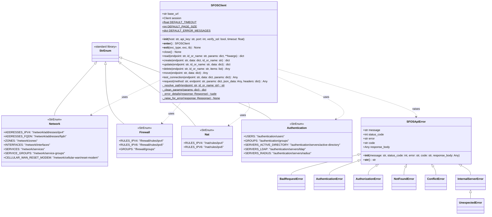

### 3.1 Structural Design & Class Taxonomy

- **Method Categorization & Functional Tiers**:
  - **Core CRUD Primitives (`read`, `create`, `update`, `delete`)**: Handle object lifecycle state, URL parameterization, query parameter normalization, collection auto-pagination, and RFC 7396 JSON merge patching, standalone actions, and parameterized RPC actions.
  - **Dedicated Convenience Wrappers (`move`, `test_connection`)**: Domain-specific helpers issuing direct POST requests (`.../move`, `.../test-connection`). They provide clean, validated, and ergonomic interfaces without requiring callers to construct raw strings manually.
  - **Transport & Lifecycle (`request`, `close`)**: Provide raw HTTP access and deterministic socket lifecycle management.
- **Encapsulation of Connection State**: `SFOSClient` encapsulates the `httpx.Client` instance and maintains immutable configuration properties (`base_url`, `timeout`, `verify_ssl`).
- **Static & Class Helper Methods**:
  - `_resolve_path(endpoint, id_or_name)`: Pure function transforming domain constants and identifiers into path strings without side effects.
  - `_clean_params(params)`: Strips `None` values from parameter maps so optional parameters are not serialized as literal `"None"` in URL query strings.
  - `_error_details(response)`: Robustly parses firewall response payloads whether delivered as structured JSON or plain text.
- **Exception Class Polymorphism**: Consumers can catch high-level `SFOSApiError` to handle all client failures, or trap specific subtypes (`ConflictError`, `NotFoundError`) for granular recovery logic.

### 3.2 Invariant Guarantees & Type Safety

The class hierarchy enforces several critical runtime invariants:
1. **Type Homogeneity via `StrEnum`**: All 187 endpoint constants inherit directly from `str` and `enum.Enum`. Any function or library accepting `str` can consume an endpoint constant without explicit casting. Static type checkers (e.g. `pyright`, `mypy`) validate endpoint arguments as type-compatible with string path parameters.
2. **Immutability of Base URL & Credentials**: Once instantiated, `SFOSClient.base_url` is constructed via `f"https://{host}:{port}/api/firewall-config/v1/"`. The scheme `https` is non-negotiable; passing `http://` in `host` triggers an immediate `ValueError`, ensuring security invariants cannot be broken at runtime.
3. **Session Resource Determinism**: `SFOSClient` implements Python's Context Manager protocol (`__enter__` and `__exit__`). Upon context exit, `session.close()` is guaranteed to execute, terminating keep-alive connections and preventing file descriptor leaks in long-running services.

[↑ Back to Top](#top)

---

## 4. Use Case UML Diagram

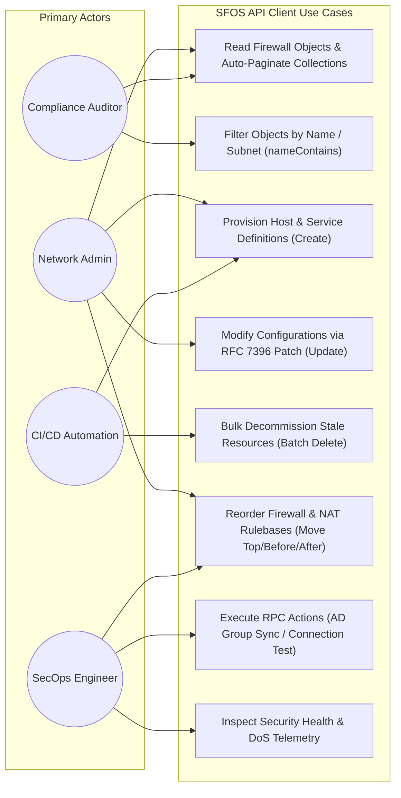

### 4.1 Actor Profiles & Operational Scenarios

- **Network Administrator**: Automates routine changes, such as spinning up new branch networks, creating zone bindings, and inserting firewall rules into production rulebases.
- **SecOps Engineer**: Manages threat feed synchronizations (`ActiveThreatResponse.FEEDS`), monitors DoS flood attack telemetry, and enforces TLS inspection policies.
- **CI/CD Automation Pipeline**: Runs automated testing or staging deployments, provisioning ephemeral IP address objects and tearing them down via batch deletion (`client.delete(..., items=[...])`).
- **Compliance Auditor**: Queries the firewall in a read-only capacity, auto-paginating through entire rulebases to verify compliance with organizational security benchmarks.

[↑ Back to Top](#top)

---

## 5. Sequence Diagrams

### 5.1 Client Session Lifecycle & Auto-Pagination

This sequence traces the initialization of an HTTPS session, the automatic multi-page negotiation loop, and transport teardown:

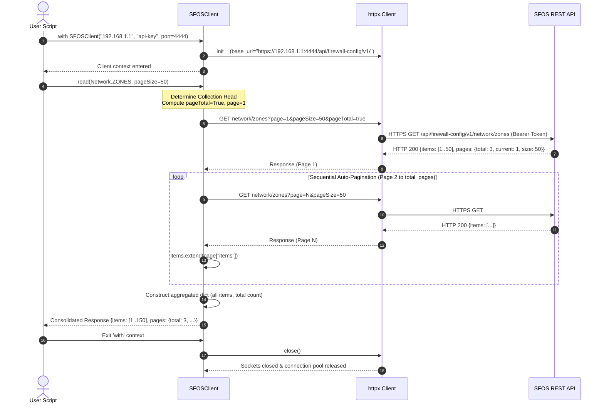

#### Detailed Sequence Mechanics:
1. **Header Injection**: On instantiation, `httpx.Client` is configured with default headers `Authorization: Bearer <api_key>` and `Accept: application/json`.
2. **First Page Fetch**: The client sends `page=1`, `pageTotal=True`, and clamps `pageSize` between `1` and `100`.
3. **Loop Termination**: The loop executes for `page_num in range(2, total_pages + 1)`. If `total_pages <= 1`, no additional HTTP requests are emitted.
4. **Metadata Preservation**: The return dictionary preserves the exact top-level schema returned by the firewall while reporting consolidated item counts.

---

### 5.2 Resource Creation & RFC 7396 Patch Update

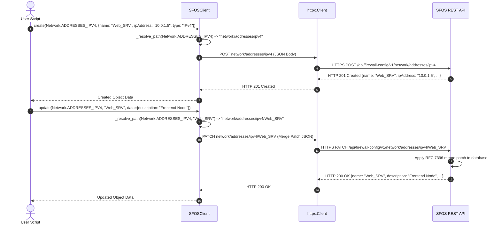

#### Detailed Sequence Mechanics:
- **Creation**: Emits `POST` directly to the collection path. The firewall returns `201 Created` with the assigned system properties.
- **Merge Patch Mutation**: `update` sends `PATCH` to the resolved resource URI. In accordance with RFC 7396:
  - Specified fields are updated.
  - Fields with `None` (`null` in JSON) are deleted/reverted to factory defaults.
  - Omitted fields (e.g. `ipAddress`) remain unchanged.

---

<a id="53-rule-priority-reordering-move"></a>
<a id="53-convenience-wrapper-rule-priority-reordering-move"></a>
### 5.3 Convenience Wrapper: Rule Priority Reordering (Move)

SFOS firewall and NAT rules are evaluated in top-to-bottom order. The `move` method is a dedicated convenience wrapper that directly issues a POST request to `f"{endpoint}/move"` to atomically adjust rule sequence priority:

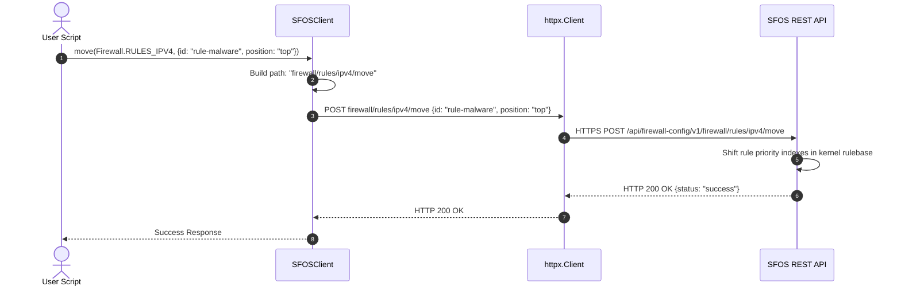

#### Detailed Sequence Mechanics:
- `client.move()` directly targets the rulebase's `/move` route, eliminating manual string construction.
- When `position` is `"top"` or `"bottom"`, the rule is moved to the respective boundary of the rulebase.
- When `position` is `"before"` or `"after"`, the caller must supply `targetRule: "<target-id>"`; the engine then shifts the rule immediately adjacent to the target rule.
- A complementary convenience wrapper, `client.test_connection(endpoint, data=data, params=params)`, directly issues a POST request to `f"{endpoint}/test-connection"` for on-demand directory, SMS gateway, and threat feed connectivity verification.

---

### 5.4 Error Interception & Exception Dispatch

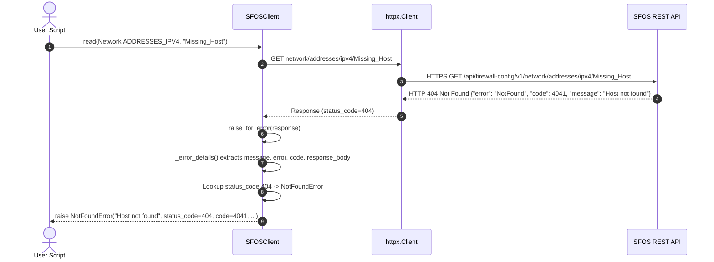

#### Detailed Sequence Mechanics:
1. `_raise_for_error` inspects `response.is_error`. If `False`, execution continues uninterrupted.
2. If `True`, `_error_details` attempts to decode the JSON response payload.
3. If the payload contains standard SFOS error keys (`message`, `error`, `code`), they are extracted. If the response is not valid JSON, raw text is preserved.
4. The client dispatches to the corresponding typed exception subclass, attaching all extracted diagnostic attributes.

---

### 5.5 Idempotent State Reconciliation Workflow

In modern Declarative / Infrastructure-as-Code pipelines (e.g. Ansible, Terraform, GitOps), automation must be safe to run repeatedly without producing spurious errors or duplicate objects. The following sequence illustrates how `sfos-api` supports declarative reconciliation:

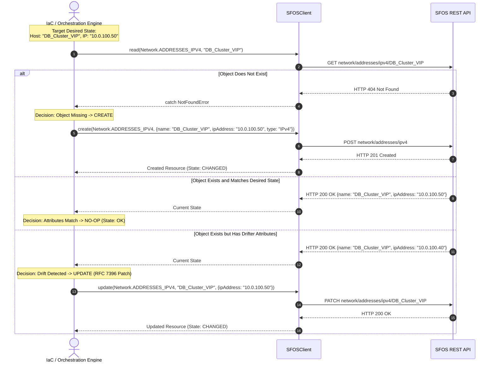

#### Detailed Sequence Mechanics:
1. **Deterministic Probing**: The orchestrator attempts a targeted `read()` for the resource key. Trapping `NotFoundError` cleanly bifurcates execution into a creation path versus a mutation/drift-check path.
2. **Atomic Convergence via Merge Patch**: When state drift is detected, `update()` sends only the mutated fields using RFC 7396 merge patch semantics, avoiding destructive full-object overwrites.
3. **Zero Phantom Changes**: If active attributes match the desired state, the workflow exits cleanly with zero write I/O against the firewall's configuration database.

[↑ Back to Top](#top)

---

## 6. Activity & Workflow Diagrams

### 6.1 Read & Auto-Pagination Decision Flowchart

The `read()` method intelligently chooses between single resource retrieval, explicit single-page queries, and auto-paginated collection aggregation:

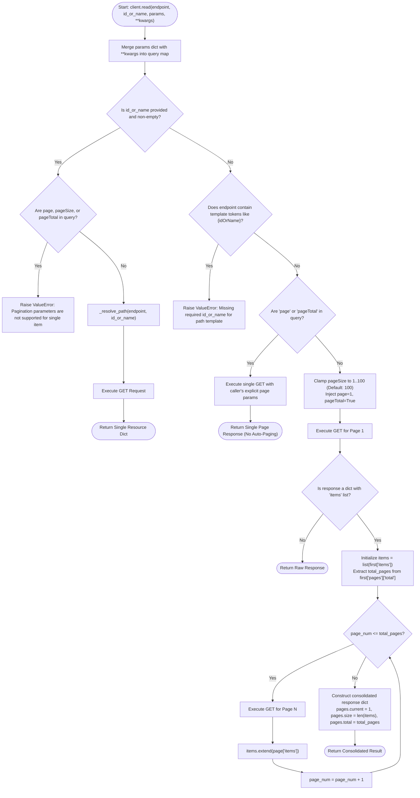

---

### 6.2 Path Parameter Resolution Algorithm

The `_resolve_path` method is a deterministic routing algorithm handling both standard collection paths and OpenAPI path templates:

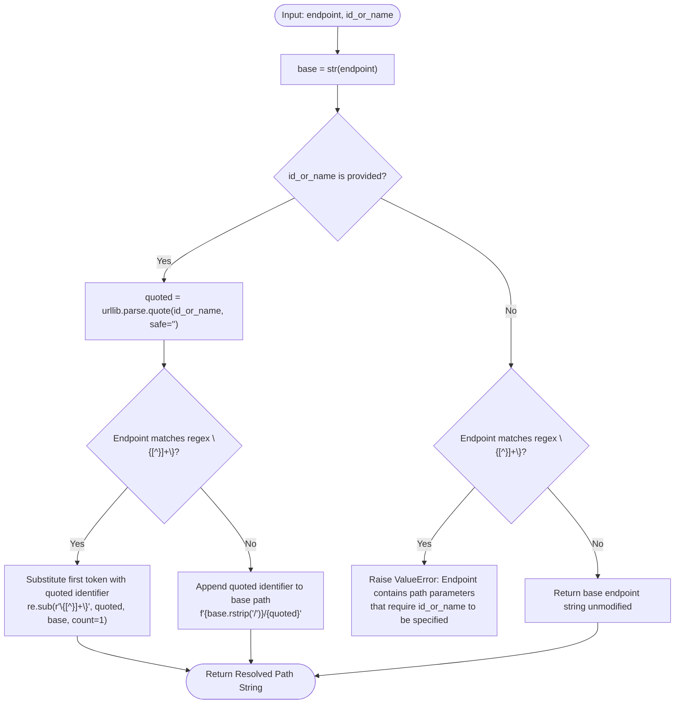

---

### 6.3 Error Handling & Response Parsing Pipeline

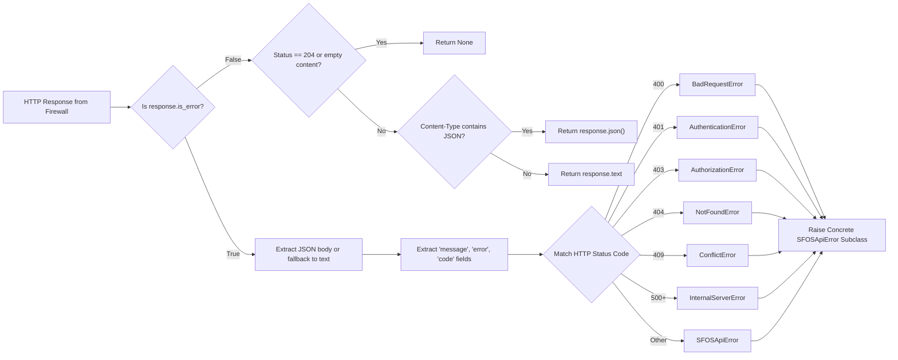

[↑ Back to Top](#top)

---

## 7. State Transition Diagram

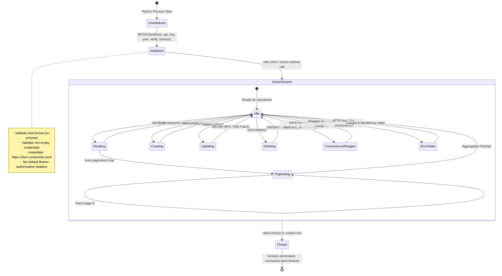

### 7.1 Client Lifecycle States & Transitions

- **`Uninitialized` ➔ `Initialized`**: Validates configuration parameters. If `host` contains a scheme (`https://`), or if `host` or `api_key` are empty strings, instantiation fails immediately with `ValueError`.
- **`ActiveSession`**: The client enters a reusable state. The internal `httpx.Client` maintains an HTTP/1.1 persistent keep-alive pool. Multiple requests reuse existing TCP/TLS handshakes, dramatically improving performance for multi-step automations.
- **`Closed`**: Disposes of internal sockets and releases all transport resources. Calling `client.close()` or exiting a `with` block guarantees zero resource leaks.

[↑ Back to Top](#top)

---

## 8. Deployment & Network Topologies

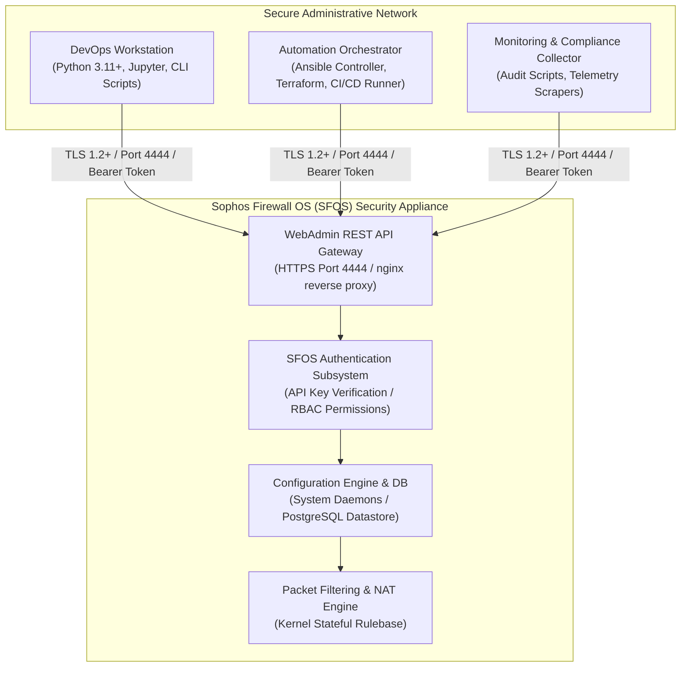

### 8.1 Firewall Communication Architecture

- **Port & Protocol**: SFOS REST API operations are served over HTTPS on the WebAdmin management port (default: `4444`, configurable via `Administration > Admin and user settings`).
- **Authentication**: Uses HTTP Bearer tokens. API keys are generated under `Administration > API` in the WebAdmin UI and mapped to firewall administrator profiles with granular Role-Based Access Control (RBAC).
- **Mutual TLS & CA Trust**: Supports standard commercial certificates, enterprise internal PKI CA bundles, or disabled validation (`verify_ssl=False`) for isolated lab deployments.

### 8.2 High Availability (HA) Cluster Topology

Sophos Firewall OS appliances are frequently deployed in High Availability (Active-Passive or Active-Active) clusters to guarantee zero-downtime perimeter security:

```mermaid
graph TB
    subgraph Management_Network["Management Subnet / DevOps Orchestration"]
        OrchestratorNode["sfos-api Client Orchestrator"]
    end

    subgraph Cluster_Boundary["Sophos Firewall HA Cluster Pair"]
        subgraph Primary_Node["Primary / Active Appliance (Node A)"]
            VIP["Virtual Management IP (e.g. 192.168.1.254:4444)"]
            NodeA_Mgmt["Auxiliary Mgmt IP (192.168.1.252)"]
            NodeA_Engine["WebAdmin REST API Gateway (Read/Write)"]
            NodeA_DB[("PostgreSQL Configuration DB (Primary Master)")]
        end

        subgraph Auxiliary_Node["Auxiliary / Standby Appliance (Node B)"]
            NodeB_Mgmt["Auxiliary Mgmt IP (192.168.1.253)"]
            NodeB_Engine["WebAdmin REST API Gateway (Read-Only)"]
            NodeB_DB[("PostgreSQL Configuration DB (Replica)")]
        end

        DedicatedLink["Dedicated HA Heartbeat & Sync Link (e.g. Port D)"]
    end

    OrchestratorNode -->|"HTTPS Port 4444 (Target VIP)"| VIP
    VIP --> NodeA_Engine
    NodeA_Engine --> NodeA_DB
    NodeA_DB <==|"Real-time DB Sync & Config Mirroring"| DedicatedLink
    DedicatedLink ==> NodeB_DB
    NodeB_DB -.-> NodeB_Engine

    OrchestratorNode -.->|Direct Node Health Check| NodeA_Mgmt
    OrchestratorNode -.->|Direct Node Health Check| NodeB_Mgmt
```

#### HA Operational Best Practices for `sfos-api`:
1. **Target Virtual Management IP (VIP)**: In production, configure `SFOSClient` with the cluster Virtual IP. In the event of a primary node failover, gratuitous ARP rebinds the VIP to the surviving node, allowing automation pipelines to resume without endpoint re-addressing.
2. **Replication Transparency**: Changes provisioned to the Primary node via `sfos-api` (e.g. firewall rules, IP host objects) are written to the primary `corporate.db` and immediately replicated to the auxiliary node across the dedicated HA interconnect link.
3. **Dedicated Auxiliary Management IP for Health Monitoring**: For monitoring telemetry, automation scripts can connect directly to the Auxiliary Node's physical management IP using `HighAvailability.STATUS` (`/high-availability/status`) to assert cluster health, heartbeat integrity, and synchronization status.

[↑ Back to Top](#top)

---

## 9. Security Architecture & Threat Model

### 9.1 Threat Mitigation Strategies

| Threat Vector | Severity | Mitigation in `sfos-api` |
|---|:---:|---|
| **Credential Interception** | Critical | Strict HTTPS enforcement; client refuses to instantiate if an unencrypted HTTP URL is supplied. |
| **Path Traversal / URL Injection** | High | All resource identifiers in `_resolve_path` are sanitized using `urllib.parse.quote(id_or_name, safe="")`, preventing path injection attacks (`../`). |
| **Credential Leakage in Logs** | Medium | The client does not log sensitive headers; API tokens are isolated in HTTP session headers and are never included in exception messages or `__str__` outputs. |
| **Unbounded Pagination Denial of Service** | Medium | `pageSize` is clamped to SFOS limits (`1` to `100`), preventing memory exhaustion on client and server. |

### 9.2 Certificate Verification Configurations

```python
# Mode 1: Strict Verification with Custom Internal CA (Recommended for Enterprise)
client = SFOSClient("fw.corp.local", "token", verify_ssl="/etc/ssl/certs/corp-root-ca.pem")

# Mode 2: Standard Public CA Verification
client = SFOSClient("fw.domain.com", "token", verify_ssl=True)

# Mode 3: Lab / Development Mode (Bypasses Self-Signed Certificate Warnings)
client = SFOSClient("192.168.1.1", "token", verify_ssl=False)
```

### 9.3 STRIDE Threat Analysis Matrix

A comprehensive STRIDE threat modeling assessment was performed on the client-to-appliance interaction:

| STRIDE Category | Threat Description | Architectural Countermeasure in `sfos-api` |
|---|---|---|
| **Spoofing** | Attacker impersonates the SFOS WebAdmin gateway using a rogue certificate or DNS poisoning. | By default, `verify_ssl=True` enforces TLS certificate chain verification against trusted CAs. Passing an enterprise CA path verifies internal PKI signatures. |
| **Tampering** | In-transit modification of firewall policy payloads (e.g. altering source IP or port definitions). | Strict TLS 1.2+ encryption prevents wire-level packet alteration. All payloads are signed and hashed by the TLS session keys negotiated during the handshake. |
| **Repudiation** | Administrator denies initiating a rulebase deletion or policy alteration. | Every API call carries the Bearer token associated with a named SFOS Administrator Profile. SFOS logs all REST mutations to `/log/syslog.log` and the WebAdmin Audit Log with the associated administrator username. |
| **Information Disclosure** | Exposure of sensitive network topology or administrative credentials in stack traces. | `SFOSApiError` custom string representation (`__str__`) sanitizes headers, outputting only the HTTP status code, API error message, and response body, guaranteeing that Bearer tokens are never leaked to log files or consoles. |
| **Denial of Service** | Excessive pagination requests consuming all firewall worker threads or exhausting client heap space. | `pageSize` is clamped to SFOS specification bounds (1–100). The auto-pagination engine executes sequentially, preventing connection exhaustion on the appliance's Nginx reverse proxy. |
| **Elevation of Privilege** | An API token with read-only rights attempts to execute mutative writes (e.g. creating rules). | The client dispatches HTTP 403 responses to `AuthorizationError`. SFOS enforces Role-Based Access Control (RBAC) at the gateway daemon, preventing privilege escalation. |

### 9.4 Enterprise Secrets Management & Key Storage

Hardcoding API tokens in scripts violates enterprise security baselines. Production deployments should resolve credentials through external secret stores:

```python
import os
from sfos_api import SFOSClient, Firewall

# Pattern A: Environment Variable Resolution (12-Factor App)
api_key = os.environ.get("SFOS_API_KEY")
if not api_key:
    raise RuntimeError("SFOS_API_KEY environment variable is mandatory")

# Pattern B: Secure Context Management
with SFOSClient("192.168.1.1", api_key, verify_ssl=True) as client:
    rules = client.read(Firewall.RULES_IPV4)
```

[↑ Back to Top](#top)

---

## 10. Concurrency, Performance & Resource Management

### 10.1 Concurrency Model & Thread Safety

- **Thread-Safe Transport**: `SFOSClient` wraps `httpx.Client`, which is thread-safe. A single `SFOSClient` instance can be shared across worker threads in multi-threaded applications (e.g. concurrent auditing across different endpoints).
- **Synchronous Design Rationale**: Network firewalls serialize configuration updates internally to prevent race conditions in the packet filtering kernel. Asynchronous parallel writes to the same rulebase frequently result in `409 Conflict` errors from the firewall engine. A synchronous client model naturally aligns with the firewall's serialized transaction model.

### 10.2 Memory Footprint & Socket Optimization

- **Zero-Copy Endpoint References**: Endpoints are interned strings in the Python interpreter. Storing 187 endpoints consumes less than 15 KB of memory.
- **Connection Keep-Alive**: Reuses underlying TCP connections across requests, eliminating the overhead of repeated TLS handshakes during large multi-page queries or bulk provisioning runs.

### 10.3 Connection Pool Management & Socket Tuning

The internal `httpx.Client` manages an HTTP/1.1 connection pool configured for high-throughput firewall administration:
- **Connection Persistence**: Active sockets are maintained in a keep-alive pool. Subsequent requests to the same firewall reuse the open socket, saving 150–300ms per call by skipping TCP 3-way handshake and TLS cipher negotiation.
- **Socket Timeouts**: Configurable per-client via `timeout` (default `30.0` seconds). Long-running operations (such as firmware backup creation or Active Directory synchronization) may require higher timeouts (e.g. `timeout=60.0`).
- **Deterministic Teardown**: Implementing the context manager protocol (`with SFOSClient(...) as client:`) ensures that `session.close()` executes even in the event of unhandled exceptions, closing lingering sockets and preventing resource leaks.

[↑ Back to Top](#top)

---

## 11. Extensibility & Integration Patterns

### 11.1 Low-Level Escape Hatch (`client.request`)

For newly released SFOS endpoints or custom undocumented RPC paths not yet covered in `endpoints.py`, `client.request()` provides a low-level invocation mechanism while retaining authentication, error translation, and base URL routing:

```python
# Forward-compatible execution of unmodeled endpoint
custom_data = client.request(
    "POST",
    "/custom/experimental-endpoint",
    json_data={"featureFlag": True},
)
```

### 11.2 Infrastructure-as-Code (IaC) Integration

`sfos-api` is designed for embedding into custom automation engines:
- **Ansible Modules**: Can be imported into custom Ansible library modules to provision firewall objects idempotently using `read()` checks followed by `create()` or `update()`.
- **Terraform Custom Providers**: Provides clean Python bindings for Terraform provider sidecars or Pulumi dynamic providers.
- **Continuous Compliance Scrapers**: Facilitates automated drift detection by comparing active firewall states against Git-managed YAML/JSON desired-state declarations.

### 11.3 Idempotent Desired-State Loop Pattern

Below is an enterprise implementation pattern for an idempotent resource reconciler:

```python
from sfos_api import SFOSClient, Network
from sfos_api.exceptions import NotFoundError, SFOSApiError

def reconcile_ip_host(client: SFOSClient, name: str, ip: str, description: str = "") -> dict:
    """Idempotently ensures an IPv4 host object exists with the desired attributes."""
    try:
        current = client.read(Network.ADDRESSES_IPV4, name)
        # Object exists; check if drift occurred
        if current.get("ipAddress") != ip or current.get("description") != description:
            print(f"[DRIFT DETECTED] Updating {name}...")
            return client.update(Network.ADDRESSES_IPV4, name, {
                "ipAddress": ip,
                "description": description,
            })
        print(f"[IN SYNC] {name} already matches desired state.")
        return current
    except NotFoundError:
        # Object does not exist; create it
        print(f"[MISSING] Creating host object {name}...")
        return client.create(Network.ADDRESSES_IPV4, {
            "name": name,
            "ipAddress": ip,
            "type": "IPv4",
            "description": description,
        })
```

### 11.4 Observability, Auditing & Event Hook Interception

`sfos-api` can be augmented with audit logging and distributed tracing by tapping into `httpx` event hooks:

```python
import logging
import httpx
from sfos_api import SFOSClient, Firewall

logging.basicConfig(level=logging.INFO)
logger = logging.getLogger("sfos.audit")

def log_request(request: httpx.Request):
    logger.info("AUDIT OUT -> %s %s", request.method, request.url)

def log_response(response: httpx.Response):
    logger.info("AUDIT IN  <- %s (Status: %d in %.2fs)", 
                response.request.url, response.status_code, response.elapsed.total_seconds())

# Inject hooks directly into client session
with SFOSClient("192.168.1.1", "api-token", verify_ssl=False) as client:
    client.session.event_hooks["request"].append(log_request)
    client.session.event_hooks["response"].append(log_response)
    
    rules = client.read(Firewall.RULES_IPV4)
```

[↑ Back to Top](#top)

---

## 12. Domain Taxonomy & Functional Subsystem Matrix

The 29 domain `StrEnum` classes in `sfos_api.endpoints` are organized into 5 logical architectural subsystems reflecting the operational model of Sophos Firewall OS:

| Subsystem Tier | Domain Classes | Key Endpoints & Capabilities |
|---|---|---|
| **1. System & Platform Core** | `System`, `Administration`, `HighAvailability`, `BackupFirmware`, `Licensing`, `DeviceConsole` | Appliance hostname, timezone, NTP, reboot, shutdown, WebAdmin port config, HA pairing status, firmware upgrades, backup schedules, license status. |
| **2. Network Topology & Interfaces** | `Network`, `Routing`, `Sdwan`, `Wireless`, `CellularWan` | IPv4/IPv6 host objects, FQDNs, zones, physical/VLAN/bridge interfaces, static & dynamic BGP/OSPF routing, SD-WAN profiles & SLA policies, AP groups, LTE modem resets. |
| **3. Policy & Traffic Enforcement** | `Firewall`, `Nat`, `Qos`, `IntrusionPrevention`, `Ips`, `WebProtection`, `ApplicationProtection` | IPv4/IPv6 security rules, rule groups, DNAT/SNAT rules, bandwidth throttling policies, IPS signatures, DoS flood attack rules, web filtering categories, application control. |
| **4. Identity, Access & Cryptography** | `Authentication`, `Vpn`, `Profiles`, `Certificates` | Local users/groups, Active Directory/LDAP/RADIUS servers, IPsec & SSL VPN tunnels, SD-Remote access, CA certificates, CSRs, user access profiles. |
| **5. Threat Prevention & Telemetry** | `ActiveThreatResponse`, `SophosCentral`, `Reporting`, `Diagnostics` | Sophos X-Ops threat intelligence feed sync, Central management registration, firewall executive reporting, on-box diagnostic ping & traceroute tools. |

---

[↑ Back to Top](#top)


